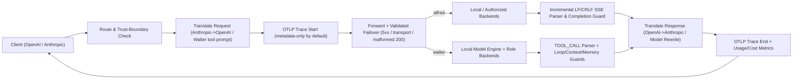

# gordon-gateway

A single, config-driven LLM gateway proxy that unifies OpenAI/Anthropic protocol translation, failover routing, prompt-injected tool-call adaptation, per-session loop/context guards, and OpenTelemetry metrics into one Python service.

## Problem

Running local open-weights models alongside OpenAI- and Anthropic-speaking clients typically fragments into three brittle proxy scripts:

1. **Protocol drift & silent stream corruption** — Anthropic clients (`/v1/messages`) need exact translation to OpenAI-compatible backends (`/v1/chat/completions`), including `thinking` blocks, tool calls, multimodal images, and `tool_choice` controls. Naive SSE parsers drop `\r\n\r\n` frames or synthesize `message_stop` / `end_turn` on empty or prematurely closed streams.
2. **Unsafe failover chains** — Treating HTTP `400` client rejections as retryable can silently replay prompts across a fallback chain into an external cloud provider, while genuine transport failures (`ConnectTimeout`, HTML/malformed `200` bodies) crash with `500` instead of failing over.
3. **Local tool-calling & session state bleed** — Local models without reliable native tool grammars need prompt-injected `TOOL_CALL:` parsing, loop/cycle breakers, context truncation, and memory guards isolated per conversation/subagent.

`gordon-gateway` solves all three in one codebase with two explicit operating modes (`alfred` and `walter`).

## Architecture



| Mode | Purpose | Default Port | Key Features |
|------|---------|--------------|--------------|
| `alfred` | Multi-backend router & Anthropic translator | `8091` | Bearer auth (`MASTER_KEY`), local/authorized fallback chains, `/v1/chat/completions` + `/v1/messages` + `/v1/messages/count_tokens`, LF/CRLF SSE framing, premature-EOF detection, OTLP tracing |
| `walter` | Local tool-call & guardrail proxy | `8080` | Prompt-injected 5-format `TOOL_CALL:` parser + JSON recovery, per-session loop/cycle/parse-error guards (LRU + TTL), context truncation, `psutil` memory warnings, idle KV-cache janitor, OTLP tracing |

## Contribution vs. Upstream

`gordon-gateway` builds directly on standard upstream libraries—**FastAPI**, **uvicorn**, **httpx**, and optional **PyYAML**, **psutil**, and **OpenTelemetry**—without forking them. Everything specific to this repository lives in [gateway.py](gateway.py):

- **Incremental LF/CRLF/CR SSE engine & completion integrity**: `parse_sse_blocks()`, `_open_upstream_sse_stream()`, `rewrite_stream_model()`, and `openai_stream_to_anthropic()` validate the first complete SSE event before committing HTTP `200`, preserve fragmented `\r\n\r\n` streams, and emit explicit `event: error` frames (never `message_stop` / `[DONE]`) on empty, truncated, or prematurely closed streams.
- **Normalized completion adapter**: `_normalize_openai_completion()` powers both `openai_to_anthropic_response()` and `_json_to_fake_sse()`, guaranteeing parity across `reasoning_content`, `content`, `tool_calls`, `finish_reason`, and `usage`.
- **Fail-closed retry & data-boundary policy**: `is_retryable_status()` and `resolve_chain()` keep HTTP `4xx` terminal by default, retry bounded transport/timeout/5xx/malformed-200 failures, and block local-to-external cloud fallback unless explicitly authorized.
- **Per-session Walter guardrails**: opaque SHA-256 session keys, bounded LRU+TTL state, loop/cycle breakers, and explicit `tool_choice="none"` handling.
- **Privacy-first telemetry**: metadata-only OTLP export by default (`TRACE_CONTENT=false`), authenticated TLS required for non-loopback collectors, and owner-only (`0600`) secret-file loading.

## Quickstart & 5-Minute Offline Demo

### 1. Clean install

```bash
python3 -m venv .venv
source .venv/bin/activate
pip install -r requirements.txt
# For running tests with pytest:
pip install -r requirements-dev.txt
# (or: pip install -r requirements.txt pytest)
# Optional runtime extras (YAML config, psutil memory warnings, OpenTelemetry):
# pip install -e ".[all]"
```

### 2. Run the synthetic offline demo (no GPU, no API keys, no network)

```bash
python3 scripts/demo_offline.py
```

Expected output:

```text
== gordon-gateway offline mock-upstream demo ==

[1/5] PASS  Fragmented CRLF SSE -> Anthropic thinking + text + tool_use preserved
[2/5] PASS  Premature EOF stream emitted `event: error` (no false `message_stop`)
[3/5] PASS  HTTP 503 failed over from primary -> local backup and recovered (HTTP 200)
[4/5] PASS  HTTP 400 terminated immediately (0 backup calls) and cloud fallback blocked by default
[5/5] PASS  Walter mode honored `tool_choice=none` and parsed `TOOL_CALL:` on `auto`

All 5 offline demo scenarios passed.
```

### 3. Run the full offline test suite (failover, recovery, SSE, session isolation)

```bash
# With pytest (installed via requirements-dev.txt):
pytest -v

# Or stdlib unittest:
python3 -m unittest discover -s tests -v
python3 -m unittest test_gateway_sessions.py -v
```

### 4. Run the server locally

```bash
# Alfred mode (routing + Anthropic translation)
export GATEWAY_MODE=alfred
export MASTER_KEY="replace-with-local-secret"
export TRACING_ENABLED=false
python3 gateway.py

# Walter mode (prompt-injected tools + loop guards)
export GATEWAY_MODE=walter
export BACKEND_URL="http://127.0.0.1:8082"
export TRACING_ENABLED=false
python3 gateway.py
```

Copy [config.example.yaml](config.example.yaml) to `~/gordon-gateway/config.yaml` (gitignored) to customize backends, fallback chains, aliases, and thresholds.

## Retry & Data-Boundary Policy

| Upstream Failure | Default Action | Override |
|------------------|----------------|----------|
| `httpx.TransportError` (`ConnectError`, `ConnectTimeout`, `ReadTimeout`, `RemoteProtocolError`, etc.) | **Retry** next backend in chain | — |
| HTTP `5xx` (`500`–`599`), swap-in identity mismatch, malformed/non-JSON `200`, empty pre-commit SSE stream | **Retry** next backend in chain | — |
| HTTP `4xx` (`400`, `401`, `403`, `404`, `422`, `429`, …) | **Terminal** — stop immediately and return upstream `4xx` | Opt in specific codes via `RETRYABLE_4XX_STATUSES` / `retryable_4xx_statuses` (e.g. `408,429`) |
| Local backend -> external/cloud fallback (`trust_boundary != "local"`) | **Blocked** — never forwards prompts outside loopback (`trust_boundary` is strictly validated against `"local"` / `"external"`, and `allow_external_fallback` rejects non-boolean values like `"false"`) | Authorize explicitly via `ALLOW_EXTERNAL_FALLBACK=true`, `EXTERNAL_FALLBACK_ROUTES`, or typed boolean `allow_external_fallback: true` on the backend |
| All backends exhausted | Return typed HTTP `502` (`all_backends_failed` + `attempts`) | — |

## Protocol Capability Matrix

| Feature | Alfred `/v1/chat/completions` | Alfred `/v1/messages` (Anthropic) | Walter `/v1/chat/completions` |
|---------|-------------------------------|-----------------------------------|-------------------------------|
| Streaming SSE (LF, CRLF, CR) | Supported (rewrites `model`) | Supported (OpenAI -> Anthropic SSE) | Supported (tool path uses heartbeats + synthesized SSE) |
| Premature / empty EOF detection | `event: error` (no `[DONE]`) | `event: error` (no `message_stop`) | Returns `502` / `[backend error]` |
| Reasoning / thinking | Pass-through | `reasoning_content` / `reasoning` -> `thinking` block (JSON + SSE + fake-SSE) | `<think>` stripped before client delivery |
| `tool_choice: "auto"` | Pass-through | Mapped to `"auto"` | Prompt-injected `TOOL_CALL:` mode |
| `tool_choice: "none"` | Pass-through | Mapped to `"none"` | Suppresses tool prompt injection (direct path) |
| `tool_choice: "any"` / `"required"` / named tool | Pass-through | Mapped to `"required"` / function object | Returns typed HTTP `400` (`unsupported_tool_choice`) |
| Images (`base64` & `url`) | Pass-through | Translated to OpenAI `image_url` blocks | Pass-through on no-tools path |
| Unsupported Anthropic blocks/options | N/A | Typed HTTP `400` (`invalid_request_error`) | N/A |
| Explicit `max_tokens` | Preserved verbatim (`DEFAULT_MAX_TOKENS` only if omitted/non-positive) | Preserved verbatim | Preserved verbatim |

## Telemetry & Secret-File Contract

- **Metadata-only telemetry by default**: `TRACE_CONTENT` defaults to `false`. Spans record only model, streaming flag, token counts, tool-call counts, latency, and `user_class`—never prompt or completion text unless you explicitly set `TRACE_CONTENT=true`.
- **Authenticated TLS outside loopback**: `OTEL_ENDPOINT` may use plaintext `http://` only on loopback (`127.0.0.1`, `localhost`, `::1`). Non-loopback collectors require `https://` (`insecure=False`) **and** an authentication header via `OTEL_EXPORTER_OTLP_HEADERS` (e.g. `authorization=Bearer <token>`).
- **Secrets contract**: `gateway.py` loads only `MASTER_KEY` and `OPENROUTER_API_KEY` from process environment variables or the owner-only (`chmod 0600`) file at `GATEWAY_SECRET_ENV` (default `~/.config/gordon-gateway/secrets.env`). Never store credentials in `config.yaml`, launchd plists, systemd units, CLI flags, or Git.

## Limitations

- **Mid-stream failover is not possible after HTTP `200` headers are sent**: once the gateway validates the first SSE event and commits downstream, a subsequent upstream disconnect cannot transparently replay onto a backup backend; instead, the gateway emits an explicit `event: error` frame so clients fail loudly rather than seeing a false completion.
- **Walter forced tool choice**: prompt-injected tool calling cannot enforce grammar-level `tool_choice: "required"` or named-function forcing, so Walter mode rejects those values with HTTP `400` rather than silently ignoring them.
- **Token counting heuristic**: `/v1/messages/count_tokens` uses a fast character-length heuristic (`len(payload) // 4`) rather than a model-specific tokenizer.
- **FastAPI lifecycle hook**: uses `@app.on_event("startup"/"shutdown")` for compatibility with existing deployments; migrating to ASGI lifespan handlers is left as a clean follow-up.

## License

MIT, see [LICENSE](LICENSE).
